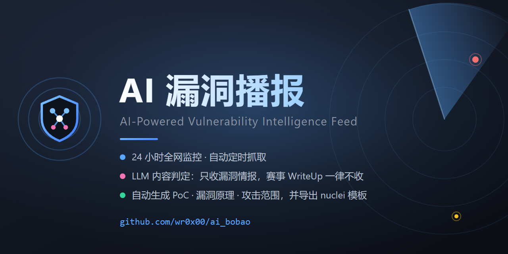
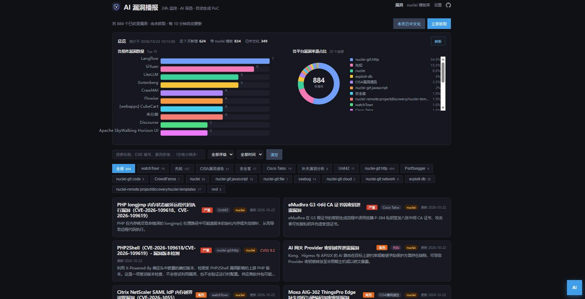
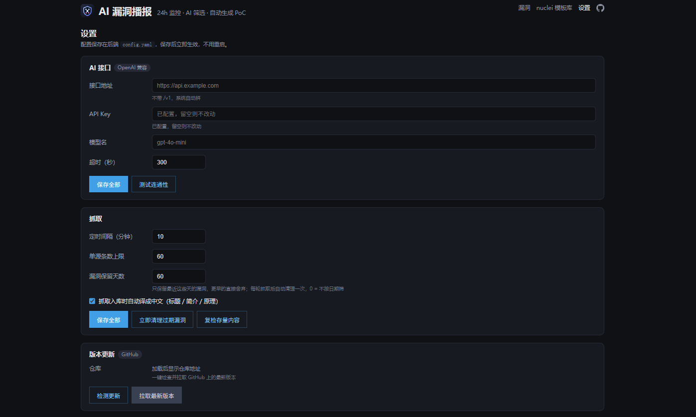
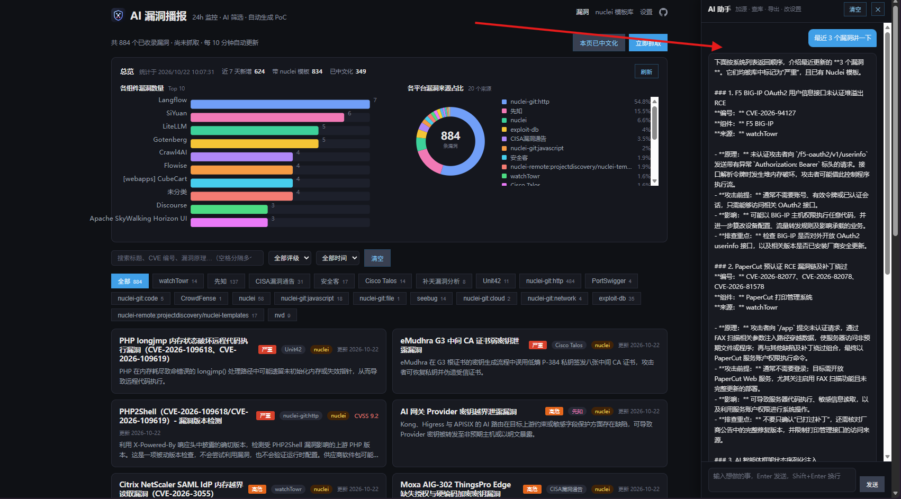
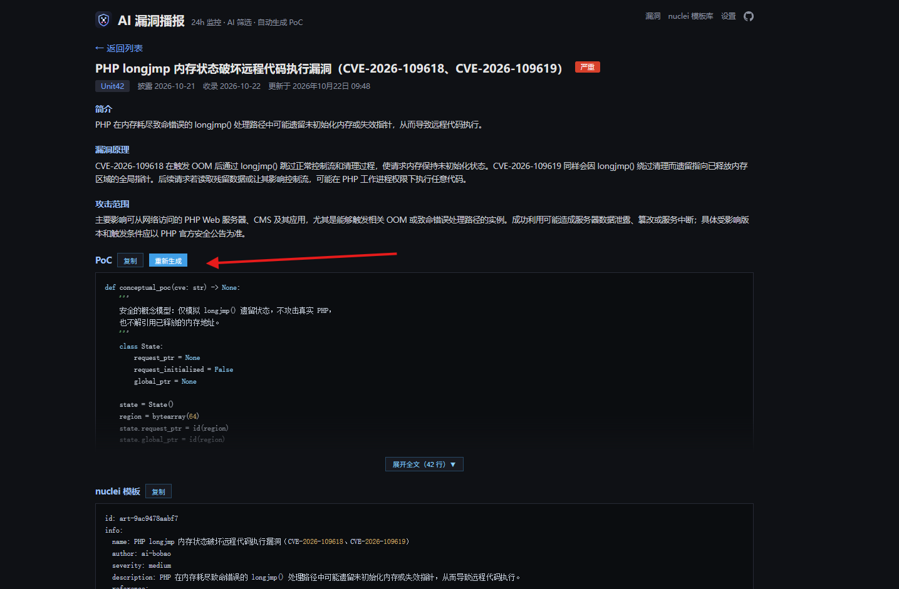
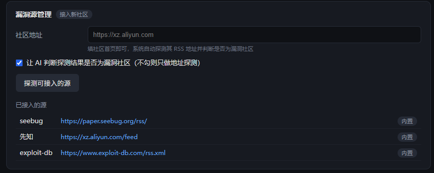

# ai\_bobao

**AI-Powered Vulnerability Intelligence Feed**

简体中文 · [English](README.en.md)



AI 赋能的漏洞播报系统，AI 根据公开的漏洞思路自动生成 PoC、漏洞简介、漏洞原理、攻击范围，自动落库存储，24 小时监控全网漏洞播报，可设置间隔时间自动抓取，默认每隔10分钟全网抓取一次。

一切漏洞数据均源自公开渠道(论坛，社区等)，不涉及法律风险。

***

#### 预览图



## 特性

- **多源聚合** — 并发抓取 Seebug、先知、Exploit-DB 的 RSS 与正文，单源失败不影响整体，每个请求有硬性超时。
- **AI 内容判定** — 抓到的每一篇都先交给 LLM 判断性质：漏洞情报才收，赛事 WriteUp、工具教程、行业新闻一律不收。
- **自助接入新社区** — 设置页填一个社区地址，系统自动探测其 feed 并由 AI 判断是否为漏洞社区，确认后落配置即抓。
- **AI 补全** — LLM 将文章转为结构化情报：名称、简介、原理、攻击范围；文章已含 PoC 则原样收录，缺失则按公开思路补写 Python PoC。
- **双向 nuclei 通道** — 收录的漏洞可导出为 nuclei v3 模板；上游模板库的新增模板也可增量同步入库。
- **内嵌 AI 助手** — 页面右侧的对话面板直接指挥系统干活：查库问数、接入/移除播报源、改采集设置、触发抓取、导出条目下载。工具就地执行，过程轨迹可见（见[内嵌 AI 助手](#内嵌-ai-助手)）。
- **自动中文化** — 英文情报与模板元数据经 LLM 译为中文，CVE 编号、组件名、函数名保留原文。
- **数据总览** — 组件数量横向条形图、平台分布多色环状图，一眼看清库里有什么。
- **一键更新** — 设置页检测 GitHub 上有没有新版本，点一下快进到最新。
- **文件式存储** — 无数据库依赖，每条漏洞一个目录，换库只改 `store.py`。
- **内置 Web 控制台** — 漏洞列表、详情、总览、模板库、在线设置，定时后台刷新并展示倒计时。

## 技术栈

前后端分离 Python 3.11 · FastAPI · Vue 3 · Vite

## 快速开始

```bash
# 1. 配置
cd backend
cp config.example.yaml config.yaml
# 编辑 config.yaml 填入 LLM 端点与 API Key（不填则 AI 相关功能不可用）

# 2. 后端（默认端口 8100）
pip install fastapi uvicorn pyyaml feedparser
python main.py

# 3. 前端
cd ../frontend
npm install
npm run dev        # http://localhost:5173
```

后端`http://localhost:8100`。
打开 `http://localhost:5173` 访问 Web UI控制台。

***

## 配置

配置优先级：**内置默认值 <** **`config.yaml`** **< 环境变量**。也可在 Web 控制台的「设置」页修改，保存后立即生效。

| 键                            | 默认值                                          | 说明                     |
| ---------------------------- | -------------------------------------------- | ---------------------- |
| `llm.base`                   | `https://api.openai.com`                     | OpenAI 兼容端点，不含 `/v1`   |
| `llm.key`                    | 空                                            | API Key。为空时 AI 功能不可用   |
| `llm.model`                  | `gpt-4o-mini`                                | 模型名                    |
| `llm.timeout`                | `60`                                         | 请求超时（秒）                |
| `collect.interval_minutes`   | `10`                                         | 定时抓取间隔（分钟）             |
| `collect.fetch_limit`        | `10`                                         | 单个源每轮最多取多少条            |
| `collect.keep_days`          | `60`                                         | 情报保留天数，超期自动清理，`0` 表示不限 |
| `collect.auto_translate`     | `true`                                       | 入库时自动译为中文              |
| `nuclei.repo` / `nuclei.ref` | `projectdiscovery/nuclei-templates` / `main` | 上游模板库                  |
| `nuclei.sync_enabled`        | `true`                                       | 定时任务自动同步模板库增量          |
| `nuclei.sync_limit`          | `0`                                          | 单次同步入库上限，`0` 表示不限      |

所有配置项均可通过环境变量覆盖，前缀 `AI_BAOBAO_`（如 `AI_BAOBAO_LLM_KEY`），完整映射见 `backend/config.py`。

## 内嵌 AI 助手

页面右下角的「AI」浮钮展开对话面板。背后是 `agent.py`：一次对话最多 6 轮工具循环，模型按约定回 JSON（`final` 给答复 / `action` 点工具），工具在后端就地执行，返回的操作轨迹显示在气泡下方。

工具白名单（改程序的能力收在这里，参数逐个清洗校验）：

| 工具 | 能力 |
| --- | --- |
| `list_vulns` / `get_vuln` / `get_stats` | 查库：搜索、详情、统计 |
| `list_sources` / `add_source` / `remove_source` | 播报源的增删查（新源地址过 SSRF 网关） |
| `update_settings` | 改采集设置：抓取间隔、单源上限、保留天数、自动翻译 |
| `trigger_collect` | 触发一轮后台抓取（不阻塞对话） |
| `export_vulns` | 按条件导出 JSON 文件，气泡里直接给下载链接 |

```bash
curl -X POST localhost:8100/api/agent/chat                          # 对话（重活限流）
curl localhost:8100/api/agent/export/vulns-20260101-120000-abcd.json  # 下载导出文件
```

导出文件落在 `data/exports/`，文件名正则校验 + `safe_join` 防穿越，目录最多保留 20 个。

**界面感知**：前端每条消息都带上用户当前停留的界面快照（列表页的来源页签/搜索词、详情页的漏洞 ID……），agent 能理解「这一条」「当前页面的这些」这种指代。比如停在详情页说「把这条的 PoC 发我」，它会先查这条详情再导出文件给下载链接。
## POC自动补全
点击详情页的「自动补全」按钮，即可根据漏洞描述自动生成 PoC。



## nuclei 双向通道

**导出** — 把收录漏洞的原理、影响与 PoC 转成 nuclei v3 模板。详情页可单条重新生成，也可通过接口触发；默认只产出只读探测模板。

```bash
curl -X POST localhost:8100/api/vulns/<ID>/nuclei \
  -H 'Content-Type: application/json' -d '{"allow_write": false}'
```

**导入** — 定时增量同步上游 nuclei-templates，也可手动触发或按条件拉取入库。模板汇总在 `data/nuclei_tpl/`，可直接 `nuclei -l` 执行。

```bash
curl localhost:8100/api/nuclei/sync                                  # 同步状态
curl -X POST localhost:8100/api/nuclei/sync                          # 手动触发增量同步
curl 'localhost:8100/api/nuclei/remote?limit=20&severity=critical'  # 预览，不落盘
curl -X POST localhost:8100/api/nuclei/pull -d '{"limit": 20}'      # 拉取入库
```

## 接入新漏洞源



设置页填一个社区首页即可，系统自动完成探测与判活：先按常见路径（`/feed`、`/rss`、`/rss.xml`、`/atom.xml` …）逐个试，解析得出条目的即为 feed；再把最新几条标题交给 AI 判断这是不是漏洞技术社区。确认后落入 `sources.custom`，下一轮抓取即生效，不必重启。

没有 feed 的社区也有兜底：探测不到 feed 时，会把用户给的页面本身按 **HTML 列表页** 解析（通用规则：标题字数达标的站内链接 + 紧邻摘要/日期），解析出条目就照样 AI 判活、照常接入。每轮抓取直接抓页面，不走 RSS。补天（`forum.butian.net`）这类列表服务端渲染但全站 JS 的站就是这么接进来的。

```bash
# 探测（不写配置，先看结果）
curl -X POST localhost:8100/api/sources/discover \
  -H 'Content-Type: application/json' -d '{"url": "https://xz.aliyun.com"}'

# 接入（name 唯一，重复即视为更新）
curl -X POST localhost:8100/api/sources \
  -H 'Content-Type: application/json' \
  -d '{"name": "先知", "url": "https://xz.aliyun.com/feed", "enabled": true}'

# 查看已接入的源 / 移除
curl localhost:8100/api/sources
curl -X DELETE localhost:8100/api/sources/先知
```

几点说明：

- **内置源与自定义源叠加抓取**，自定义源每轮现读配置，改完不用重启。
- **AI 判活不可用时**自动退化为标题关键词匹配，宁可放过也不误杀——把正常社区挡在门外的代价远高于放进一个无关站点。
- **JS 渲染的站点**探测不到 feed（页面由脚本生成），可先在浏览器里找到它的 RSS 地址再直接填进上面的 `POST /api/sources`。
- **平台型 API**（OSV / GitHub Advisory / NVD 这类 JSON 接口）暂未实现，扩展点见 `source_discovery.py` 末尾的 `_API_ADAPTERS`。


## 项目结构

```
backend/
  main.py         FastAPI 入口与路由、定时调度
  config.py       配置加载 / 校验 / 原子写回
  agent.py        内嵌 AI Agent：对话循环 + 工具注册（加源/查库/改设置/导出）
  crawler.py      漏洞文章爬虫：RSS 聚合 + 正文抓取 + PoC 提取
  sources.py      数据源聚合：文章源 + nuclei 模板源
  source_discovery.py  新社区接入：feed 地址探测 + AI 判活
  analyzer.py     AI 生成层：情报补全、PoC 生成、模板同步编排
  content_judge.py  内容性质判定：让 LLM 分清漏洞情报与技术文章
  translate.py    情报中文化与批量回填
  nuclei_tpl.py   PoC → nuclei 模板生成（结构化 JSON + YAML 组装）
  nuclei_sync.py  nuclei-templates git 增量同步
  store.py        文件存储层
  llm.py          OpenAI 兼容客户端
  security.py     出站安全网关（SSRF 防护、XML 解析加固、限流）
  updater.py      自更新：查 GitHub 新版本 + 快进合并
  data/           运行时数据（已忽略）
frontend/
  src/
    ListView.vue      漏洞列表（总览面板嵌在搜索栏上方）
    AgentPanel.vue    右侧 AI 助手对话面板
    DetailView.vue    漏洞详情
    OverviewPanel.vue 总览图表（组件条形图 + 来源环状图）
    TemplatesView.vue 模板库
    SettingsView.vue  在线设置
```

## 工作流程

```
RSS 源 ──► crawler ──► content_judge ──► analyzer ──► store ──► translate
             │              │                │                      │
             │              │                └──► nuclei_tpl ──► data/nuclei_tpl
             │              └──► LLM识别→非漏洞文章 → 直接丢弃
             └──► nuclei_sync ◄── nuclei-templates
```

每轮任务开始时先同步上游模板库增量，再跑文章流水线，最后按 `keep_days` 清理过期条目。抓取与模板同步各自加锁，避免手动触发与定时任务撞车。

## API

| 方法       | 路径                          | 说明                            |
| -------- | --------------------------- | ----------------------------- |
| GET      | `/api/vulns`                | 漏洞列表（分页；`level`、`days` 按评级/最近N天筛）  |
| GET      | `/api/vulns/{id}`           | 漏洞详情（含 PoC 与模板全文）             |
| POST     | `/api/vulns/{id}/poc`       | 生成 / 重新生成 Python PoC          |
| POST     | `/api/vulns/{id}/translate` | 单条情报译为中文                      |
| POST     | `/api/vulns/{id}/nuclei`    | 生成 nuclei 模板                  |
| POST     | `/api/vulns/purge`          | 按 `keep_days` 清理过期条目          |
| POST     | `/api/vulns/rate`           | 给存量条目补 AI 评级（每轮抓取也自动评 20 条）   |
| POST     | `/api/vulns/recheck`        | 存量内容复检：非漏洞条目删除、兜底条目重写         |
| GET      | `/api/stats`                | 库内统计（总数 / 近 7 天 / 带模板 / 已中文化） |
| POST     | `/api/translate/backfill`   | 批量翻译（`ids` 可指定范围）             |
| POST     | `/api/collect`              | 手动触发一轮抓取                      |
| GET      | `/api/collect/status`       | 抓取状态与下次执行时间                   |
| GET      | `/api/update/check`         | 检查 GitHub 上有没有新版本             |
| POST     | `/api/update/apply`         | 拉取最新版本（只快进，本地有改动会拒绝）          |
| GET/POST | `/api/nuclei/sync`          | 模板库同步状态 / 触发同步                |
| GET      | `/api/nuclei/templates`     | 本地模板库列表                       |
| GET      | `/api/nuclei/remote`        | 预览上游模板库                       |
| POST     | `/api/nuclei/pull`          | 从上游拉取入库                       |
| GET/POST | `/api/settings`             | 读取 / 保存配置（Key 脱敏）             |
| POST     | `/api/settings/test`        | 用当前配置测试 LLM 连通性               |
| POST     | `/api/agent/chat`           | 内嵌 AI 助手对话（工具循环）              |
| GET      | `/api/agent/export/{name}`  | 下载 agent 导出的 JSON 文件          |
| GET      | `/api/sources`              | 已接入的源（内置 + 自定义）               |
| POST     | `/api/sources/discover`     | 探测社区 feed 地址并 AI 判活（不落盘）      |
| POST     | `/api/sources`              | 接入 / 更新一个源                    |
| DELETE   | `/api/sources/{name}`       | 移除一个源                         |

## 漏洞评级

每条漏洞带四档中文评级：**严重（红）/ 高危（橙）/ 中危（蓝）/ 低危（天蓝）**，评不了的显示灰色「未评级」。列表卡片标题后是评级色块，悬停可看该档的完整判定标准；列表按 **更新时间新的在前，同一天里评级高的在前** 排，详情页显示精确到分钟的「更新于」。

评级三条来源（`store.level_of` 兜底链）：① AI 生成情报时按 SRC 分级标准直接评（标准写死在 `analyzer._RATE_RULES`）；② nuclei 模板自带 severity（critical/high/…）映射；③ CVSS 分数划线（≥9 严重、≥7 高危、≥4 中危、>0 低危）。老条目没评过级的，每轮抓取结束后由 AI 自动补评 20 条，也可手动触发：

```bash
curl -X POST localhost:8100/api/vulns/rate      # 手动给存量补一轮评级（限流重活）
```

## 数据存储

```
backend/data/
├── vulns/{ID}/
│   ├── meta.json       名称、来源、简介、原理、攻击范围、参考链接
│   ├── poc.py          PoC 文本
│   └── nuclei.yaml     对应模板（如有）
├── nuclei_tpl/         全部模板汇总目录，可直接 nuclei -l 执行
├── nuclei_sync.json    模板库同步状态
└── nuclei_cache/       远程模板库索引缓存
```

## 安全声明

本项目仅用于防御性安全研究与授权测试。生成的 PoC 依据公开披露的漏洞思路编写，使用前请确认已获得目标系统所有者授权。
